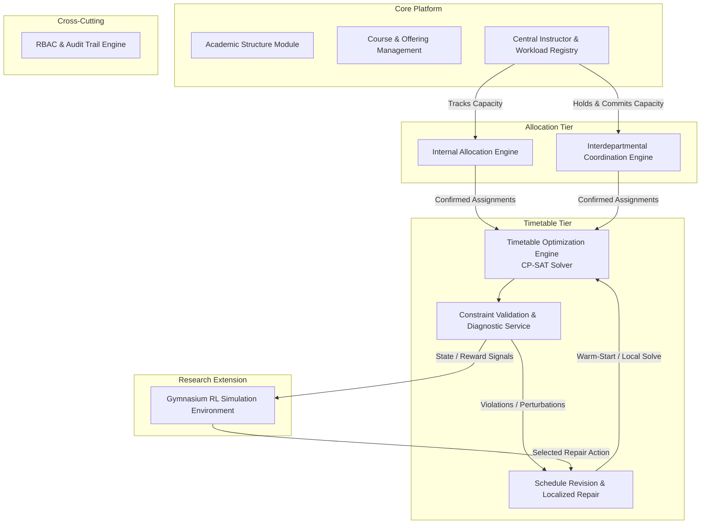
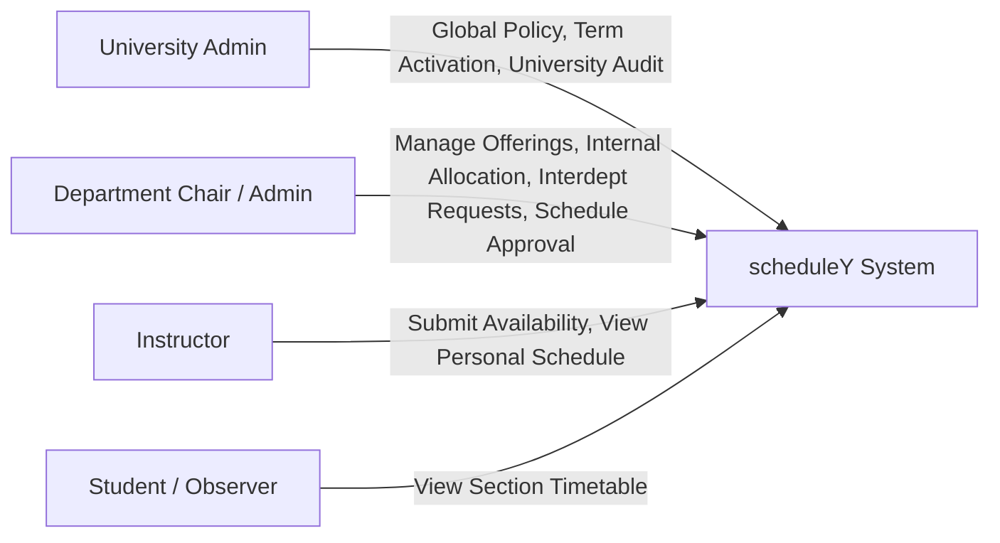
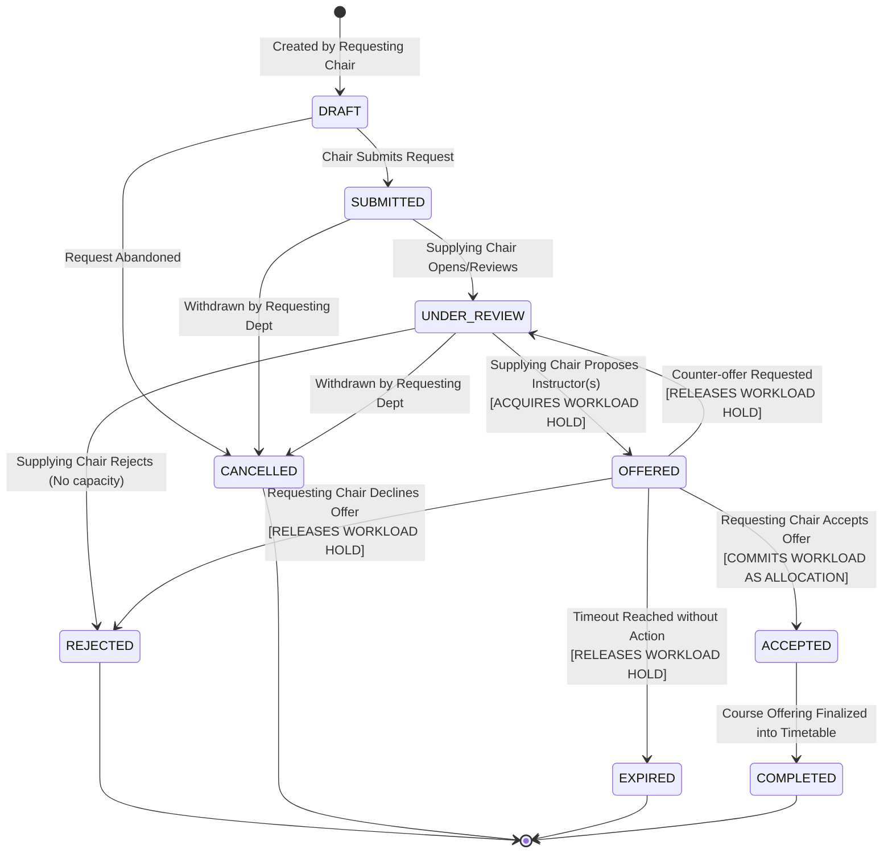
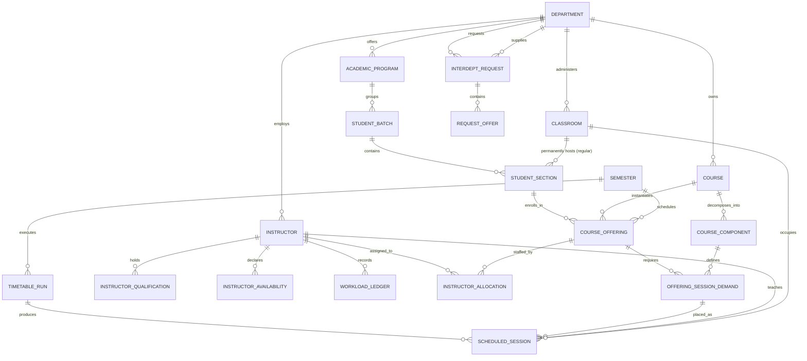
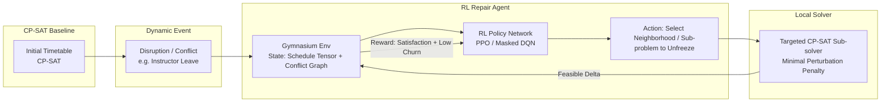
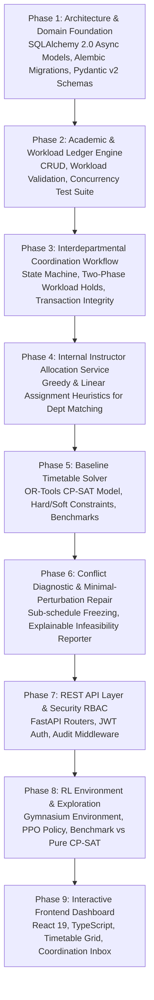

# University Intelligent Scheduling and Resource Allocation System (scheduleY)
## Comprehensive System Architecture & Requirements Analysis

---

## 1. Project Requirements Decomposition & Architectural Analysis

### 1.1 Executive System Scope
The objective is an enterprise-grade academic resource management, instructor allocation, and timetable generation platform for multi-departmental universities. Unlike simple standalone timetable generators (which treat scheduling as an isolated constraint satisfaction puzzle), this system explicitly models the **socio-organizational lifecycle** of academic operations:

1. **Organizational Hierarchy**: University $\rightarrow$ Departments $\rightarrow$ Programs $\rightarrow$ Batches $\rightarrow$ Sections $\rightarrow$ Fixed Regular Classrooms.
2. **Workload Governance**: University-wide instructor capacity limits, multi-department consumption tracking, and strict concurrency protection against over-allocation.
3. **Decoupled Two-Tier Scheduling**:
   - **Tier 1 (Resource Allocation)**: Matching instructors to course offerings (internally and via cross-departmental negotiation).
   - **Tier 2 (Temporal & Spatial Scheduling)**: Dispatching assigned offerings into time slots, fixed section classrooms, and specialized shared facilities (e.g., laboratories).
4. **Deterministic Validation & Diagnostic Feedback**: An explainability layer capable of diagnosing infeasibility and pinpointing conflicting constraints.
5. **Intelligent Optimization & Extensibility**: A robust Google OR-Tools CP-SAT baseline solver, complemented by an exploratory Reinforcement Learning (RL) simulation environment for minimal-perturbation schedule repair.

---

### 1.2 Core Architectural Tensions & Strategic Decisions

| Architectural Tension | Problem Context | Architectural Strategy |
| :--- | :--- | :--- |
| **Workload Double-Spending** | Multiple departments simultaneously request an instructor whose remaining capacity is insufficient for both. | **Workload Ledger & Two-Phase Reservation**: Treat instructor workload like a financial balance. Requests place a temporary hold; offer acceptance commits the transaction via PostgreSQL row-level locks (`SELECT ... FOR UPDATE`) or an append-only allocation ledger. |
| **Static vs. Dynamic Rooms** | University policy mandates that each student section has a permanent classroom for the semester, but laboratories are shared campus-wide. | **Hybrid Spatial Architecture**: Fixed classroom binding is an invariant property of the `StudentSection` entity. Lecture sessions inherit this room automatically. Only specialized spaces (Labs, Studios) enter the dynamic room allocation pool during timetabling. |
| **Credit Hours vs. Contact Hours** | A course might grant 3 academic credits but require 2 hours of lecture + 2 hours of practical lab (4 weekly contact hours). | **Component-Based Course Offering Model**: Split each `CourseOffering` into `OfferingComponents` (e.g., Component 1: Lecture, 2h/week, Lecture Hall; Component 2: Practical, 2h/week, Computer Lab). Workload calculations map from contact hours to teaching credits via a configurable policy formula. |
| **Coupled vs. Decoupled Timetabling** | Attempting to solve instructor assignment, room assignment, and timeslot placement simultaneously in one massive solver run leads to combinatorial explosion and poor explainability. | **Staged Pipeline Architecture**: Phase A handles Instructor Allocation (who teaches what). Phase B handles Timetable Placement (when and where). This mirrors real university governance and cuts solver search space by several orders of magnitude. |
| **Optimization vs. RL Hype** | Using RL to solve timetable generation from scratch suffers from sparse rewards, sample inefficiency, and failure to strictly guarantee hard constraints. | **Optimization-First, RL-Augmented**: Use CP-SAT (Constraint Programming with SAT solver) as the bedrock for initial schedule generation. Position RL strictly as a meta-heuristic policy for *schedule revision and repair* (neighborhood search / perturbation selection). |

---

## 2. Functional Module Decomposition



### Module Breakdown:
1. **Academic Structure Module (`core.academic`)**: University, Departments, Buildings, Rooms, Academic Years, Semesters, Programs, Student Batches, and Student Sections (with permanent room bindings).
2. **Course & Offering Management (`core.courses`)**: Course catalog, course component decomposition (Lecture, Lab, Tutorial), contact vs. credit hours, required instructor qualifications.
3. **Central Instructor & Workload Registry (`core.instructors`)**: Instructor profiles, qualifications, workload caps, availability time-masks, and university-wide workload tracking.
4. **Internal Allocation Engine (`allocation.internal`)**: Automated greedy/optimal recommendation of departmental faculty to departmental course offerings based on qualifications and load limits.
5. **Interdepartmental Coordination Engine (`allocation.interdept`)**: Formal asynchronous negotiation state machine (Request $\rightarrow$ Review $\rightarrow$ Offer $\rightarrow$ Accept/Reject) with transactional workload reservation.
6. **Timetable Optimization Engine (`timetabling.solver`)**: Google OR-Tools CP-SAT model encoding hard constraints (clashes, room limits, availability) and soft optimization metrics (gaps, distribution).
7. **Constraint Validation & Diagnostic Service (`timetabling.diagnostics`)**: Standalone deterministic verification engine that independently validates any timetable matrix against all constraints and generates human-readable diagnostics.
8. **Schedule Revision & Localized Repair (`timetabling.repair`)**: Sub-timetable extraction and re-optimization with minimal perturbation penalty relative to the original schedule.
9. **Gymnasium RL Simulation Environment (`research.rl`)**: OpenAI/Farama Gymnasium compliant environment representing schedule states, conflict actions, and soft-penalty reward dynamics.
10. **RBAC & Audit Trail Engine (`core.security`)**: Authentication, role permissions, and immutable audit logging for all allocation decisions and schedule edits.

---

## 3. Actors and Responsibilities (RBAC)



### Role Permissions Matrix:

| Capability | University Admin | Department Chair | Instructor | Student / Public |
| :--- | :---: | :---: | :---: | :---: |
| Create Departments, Terms, Buildings | **Full (Write)** | Read-Only | Read-Only | No Access |
| Manage Department Courses & Programs | Write (Global) | **Write (Own Dept)** | Read-Only | Read-Only |
| Set Instructor Workload Limits | **Write (Policy)** | Propose / Read | Read-Only | No Access |
| Submit Instructor Availability | Write (Override) | Write (Override) | **Write (Own)** | No Access |
| Assign Regular Classroom to Section | Write (Global) | **Write (Own Dept)** | Read-Only | Read-Only |
| Run Internal Allocation Engine | Trigger (Any) | **Trigger (Own Dept)**| No Access | No Access |
| Submit Cross-Dept Instructor Request | Supervise / Intervene | **Initiate (Own Dept)**| No Access | No Access |
| Offer Instructor to External Request | Supervise / Intervene | **Approve (Own Dept)**| Read (Notified) | No Access |
| Accept / Reject External Offer | Supervise / Intervene | **Accept (Own Dept)** | Read (Notified) | No Access |
| Generate Semester Timetable | **Trigger (University)**| Trigger (Dept Scope)| No Access | No Access |
| Publish Official Timetable | **Approve & Publish** | Propose Revision | Read-Only | Read-Only |
| Access Audit Trail & System Diagnostics | **Full** | Department Scope | Personal Scope | No Access |

---

## 4. Academic Workflow & Interdepartmental Coordination Lifecycle

### 4.1 Master Semester Timeline

```mermaid
sequenceDiagram
    autonumber
    actor UA as University Admin
    actor DC_A as Dept A Chair (Requesting)
    actor DC_B as Dept B Chair (Supplying)
    participant SYS as scheduleY Core Engine
    participant SOLVER as CP-SAT Timetable Solver

    Note over UA, SYS: Phase 1: Academic Setup
    UA->>SYS: Initialize Academic Year & Semester; Set Workload Caps
    DC_A->>SYS: Configure Programs, Batches, Sections, and Static Classrooms
    DC_A->>SYS: Define Course Offerings for Semester

    Note over DC_A, SYS: Phase 2: Internal Instructor Allocation
    DC_A->>SYS: Trigger Internal Allocation Solver
    SYS-->>DC_A: Recommended Internal Assignments
    DC_A->>SYS: Approve Internal Assignments (Workload committed)

    Note over DC_A, DC_B: Phase 3: Interdepartmental Coordination
    DC_A->>SYS: Create Request for External Instructor (e.g., Math for CS)
    SYS->>DC_B: Dispatch Notification of Incoming Request
    DC_B->>SYS: Review Available Instructors & Submit Offer (Instructor X, 3 Hours)
    SYS->>SYS: Place Temporary Workload Hold on Instructor X
    DC_A->>SYS: Accept Offer
    SYS->>SYS: Commit Workload Hold -> Confirmed Allocation

    Note over UA, SOLVER: Phase 4: Timetable Generation
    UA->>SOLVER: Trigger Central Timetabling (All Offerings + Rooms + Availability)
    SOLVER-->>SYS: Feasible / Optimized Timetable Generated
    SYS->>UA: Conflict Diagnostic Report (0 Hard Conflicts, Soft Metrics)
    UA->>SYS: Publish Draft Schedule

    Note over DC_A, SYS: Phase 5: Schedule Revision & Conflict Repair
    DC_A->>SYS: Request Adjustment (e.g. Instructor emergency change)
    SYS->>SOLVER: Run Localized Repair (Fix unaffected sessions, solve delta)
    SOLVER-->>SYS: Updated Schedule with Minimal Perturbation
    UA->>SYS: Publish Final Timetable
```

---

### 4.2 Interdepartmental Request State Machine & Transactional Lifecycle

A critical requirement is that two departments cannot simultaneously commit the same instructor's remaining workload. Below is the state transition specification:



#### State Integrity Invariants:
1. When transitioning from `UNDER_REVIEW` to `OFFERED`:
   - System checks: $\text{Current Committed Load} + \text{Active Holds} + \text{Offered Hours} \le \text{Max Permitted Load}$.
   - If valid, a `WorkloadHold` record is atomically created with an expiration timestamp (`expires_at = NOW() + INTERVAL '72 hours'`).
2. When transitioning to `ACCEPTED`:
   - The hold is converted into a permanent `InstructorAllocation` record within a single database transaction.
3. If an offer is `REJECTED`, `CANCELLED`, or `EXPIRED`:
   - The hold is dropped immediately, releasing capacity back to the instructor's pool.

---

## 5. Major Entities and Relational Architecture



---

## 6. PostgreSQL Database Architecture

### 6.1 Schema Design Principles
- Strict typing with standard PostgreSQL types (`UUID`, `VARCHAR`, `INTEGER`, `NUMERIC(4,2)`, `BOOLEAN`, `TIMESTAMPTZ`, `JSONB`).
- **Composite Unique Keys** to make duplicate allocations impossible at the schema level.
- **CHECK constraints** to guarantee non-negative workloads, valid capacities, and chronological validity.
- **Append-only ledger / row locks** for workload concurrency control.

### 6.2 Key Tables DDL Specification

```sql
-- Core Academic Structures
CREATE TABLE departments (
    id UUID PRIMARY KEY DEFAULT gen_random_uuid(),
    code VARCHAR(16) NOT NULL UNIQUE,
    name VARCHAR(128) NOT NULL,
    created_at TIMESTAMPTZ NOT NULL DEFAULT NOW()
);

CREATE TABLE academic_semesters (
    id UUID PRIMARY KEY DEFAULT gen_random_uuid(),
    code VARCHAR(32) NOT NULL UNIQUE, -- e.g., '2026-FALL'
    name VARCHAR(64) NOT NULL,
    start_date DATE NOT NULL,
    end_date DATE NOT NULL,
    is_active BOOLEAN NOT NULL DEFAULT FALSE,
    CONSTRAINT chk_semester_dates CHECK (end_date > start_date)
);

CREATE TABLE buildings (
    id UUID PRIMARY KEY DEFAULT gen_random_uuid(),
    code VARCHAR(16) NOT NULL UNIQUE,
    name VARCHAR(128) NOT NULL
);

CREATE TYPE room_category AS ENUM ('LECTURE_HALL', 'REGULAR_CLASSROOM', 'COMPUTER_LAB', 'SCIENCE_LAB', 'SEMINAR_ROOM');

CREATE TABLE classrooms (
    id UUID PRIMARY KEY DEFAULT gen_random_uuid(),
    building_id UUID NOT NULL REFERENCES buildings(id) ON DELETE RESTRICT,
    room_number VARCHAR(32) NOT NULL,
    capacity INTEGER NOT NULL CHECK (capacity > 0),
    category room_category NOT NULL DEFAULT 'REGULAR_CLASSROOM',
    is_schedulable BOOLEAN NOT NULL DEFAULT TRUE,
    department_id UUID REFERENCES departments(id), -- NULL if central/shared
    CONSTRAINT uq_building_room UNIQUE (building_id, room_number)
);

CREATE TABLE student_sections (
    id UUID PRIMARY KEY DEFAULT gen_random_uuid(),
    department_id UUID NOT NULL REFERENCES departments(id) ON DELETE RESTRICT,
    program_code VARCHAR(32) NOT NULL,
    batch_year INTEGER NOT NULL CHECK (batch_year >= 2000),
    section_name VARCHAR(16) NOT NULL, -- e.g., 'A', 'B'
    student_count INTEGER NOT NULL CHECK (student_count > 0),
    -- MANDATORY INVARIANT: Fixed assigned classroom for the semester
    assigned_classroom_id UUID NOT NULL REFERENCES classrooms(id) ON DELETE RESTRICT,
    semester_id UUID NOT NULL REFERENCES academic_semesters(id) ON DELETE RESTRICT,
    CONSTRAINT uq_section_per_semester UNIQUE (department_id, program_code, batch_year, section_name, semester_id)
);

-- Instructor and Workload Architecture
CREATE TABLE instructors (
    id UUID PRIMARY KEY DEFAULT gen_random_uuid(),
    department_id UUID NOT NULL REFERENCES departments(id) ON DELETE RESTRICT,
    employee_id VARCHAR(32) NOT NULL UNIQUE,
    first_name VARCHAR(64) NOT NULL,
    last_name VARCHAR(64) NOT NULL,
    email VARCHAR(128) NOT NULL UNIQUE,
    max_weekly_workload NUMERIC(4,2) NOT NULL CHECK (max_weekly_workload > 0),
    is_active BOOLEAN NOT NULL DEFAULT TRUE,
    created_at TIMESTAMPTZ NOT NULL DEFAULT NOW()
);

CREATE TABLE instructor_availabilities (
    id UUID PRIMARY KEY DEFAULT gen_random_uuid(),
    instructor_id UUID NOT NULL REFERENCES instructors(id) ON DELETE CASCADE,
    semester_id UUID NOT NULL REFERENCES academic_semesters(id) ON DELETE CASCADE,
    day_of_week SMALLINT NOT NULL CHECK (day_of_week BETWEEN 1 AND 7), -- 1=Monday .. 7=Sunday
    slot_index SMALLINT NOT NULL CHECK (slot_index >= 0),
    is_available BOOLEAN NOT NULL DEFAULT TRUE,
    preference_weight NUMERIC(3,2) NOT NULL DEFAULT 1.00 CHECK (preference_weight BETWEEN 0.00 AND 1.00),
    CONSTRAINT uq_instructor_slot_avail UNIQUE (instructor_id, semester_id, day_of_week, slot_index)
);

-- Courses and Modular Components
CREATE TABLE courses (
    id UUID PRIMARY KEY DEFAULT gen_random_uuid(),
    department_id UUID NOT NULL REFERENCES departments(id) ON DELETE RESTRICT,
    code VARCHAR(32) NOT NULL UNIQUE,
    title VARCHAR(256) NOT NULL,
    credit_hours NUMERIC(4,2) NOT NULL CHECK (credit_hours > 0)
);

CREATE TABLE course_components (
    id UUID PRIMARY KEY DEFAULT gen_random_uuid(),
    course_id UUID NOT NULL REFERENCES courses(id) ON DELETE CASCADE,
    component_type room_category NOT NULL, -- e.g. LECTURE_HALL, COMPUTER_LAB
    weekly_sessions INTEGER NOT NULL CHECK (weekly_sessions > 0),
    session_duration_slots SMALLINT NOT NULL CHECK (session_duration_slots > 0), -- e.g., 2 slots for a 2-hour lab
    weekly_contact_hours NUMERIC(4,2) NOT NULL CHECK (weekly_contact_hours > 0),
    weekly_teaching_credits NUMERIC(4,2) NOT NULL CHECK (weekly_teaching_credits > 0),
    CONSTRAINT uq_course_comp UNIQUE (course_id, component_type)
);

-- Course Offerings & Allocation Tier
CREATE TABLE course_offerings (
    id UUID PRIMARY KEY DEFAULT gen_random_uuid(),
    semester_id UUID NOT NULL REFERENCES academic_semesters(id) ON DELETE RESTRICT,
    course_id UUID NOT NULL REFERENCES courses(id) ON DELETE RESTRICT,
    section_id UUID NOT NULL REFERENCES student_sections(id) ON DELETE CASCADE,
    CONSTRAINT uq_offering_course_section UNIQUE (semester_id, course_id, section_id)
);

CREATE TYPE allocation_type_enum AS ENUM ('INTERNAL', 'INTERDEPARTMENTAL');

CREATE TABLE instructor_allocations (
    id UUID PRIMARY KEY DEFAULT gen_random_uuid(),
    offering_id UUID NOT NULL REFERENCES course_offerings(id) ON DELETE CASCADE,
    course_component_id UUID NOT NULL REFERENCES course_components(id) ON DELETE RESTRICT,
    instructor_id UUID NOT NULL REFERENCES instructors(id) ON DELETE RESTRICT,
    allocation_type allocation_type_enum NOT NULL,
    credited_hours NUMERIC(4,2) NOT NULL CHECK (credited_hours > 0),
    is_confirmed BOOLEAN NOT NULL DEFAULT TRUE,
    created_at TIMESTAMPTZ NOT NULL DEFAULT NOW(),
    CONSTRAINT uq_component_allocation UNIQUE (offering_id, course_component_id)
);

-- Interdepartmental Coordination Workflow
CREATE TYPE interdept_status_enum AS ENUM (
    'DRAFT', 'SUBMITTED', 'UNDER_REVIEW', 'OFFERED', 'ACCEPTED', 'REJECTED', 'CANCELLED', 'EXPIRED'
);

CREATE TABLE interdepartmental_requests (
    id UUID PRIMARY KEY DEFAULT gen_random_uuid(),
    request_number VARCHAR(32) NOT NULL UNIQUE,
    semester_id UUID NOT NULL REFERENCES academic_semesters(id) ON DELETE RESTRICT,
    requesting_dept_id UUID NOT NULL REFERENCES departments(id) ON DELETE RESTRICT,
    supplying_dept_id UUID NOT NULL REFERENCES departments(id) ON DELETE RESTRICT,
    offering_id UUID NOT NULL REFERENCES course_offerings(id) ON DELETE CASCADE,
    course_component_id UUID NOT NULL REFERENCES course_components(id) ON DELETE RESTRICT,
    required_hours NUMERIC(4,2) NOT NULL CHECK (required_hours > 0),
    required_qualification_tag VARCHAR(64),
    status interdept_status_enum NOT NULL DEFAULT 'DRAFT',
    remarks TEXT,
    created_at TIMESTAMPTZ NOT NULL DEFAULT NOW(),
    updated_at TIMESTAMPTZ NOT NULL DEFAULT NOW(),
    CONSTRAINT chk_different_depts CHECK (requesting_dept_id <> supplying_dept_id)
);

CREATE TABLE request_offers (
    id UUID PRIMARY KEY DEFAULT gen_random_uuid(),
    request_id UUID NOT NULL REFERENCES interdepartmental_requests(id) ON DELETE CASCADE,
    instructor_id UUID NOT NULL REFERENCES instructors(id) ON DELETE RESTRICT,
    offered_hours NUMERIC(4,2) NOT NULL CHECK (offered_hours > 0),
    hold_expires_at TIMESTAMPTZ NOT NULL,
    is_active_hold BOOLEAN NOT NULL DEFAULT TRUE,
    offered_at TIMESTAMPTZ NOT NULL DEFAULT NOW(),
    decision_at TIMESTAMPTZ
);

-- Timetable Engine Output & Audit
CREATE TABLE timetable_runs (
    id UUID PRIMARY KEY DEFAULT gen_random_uuid(),
    semester_id UUID NOT NULL REFERENCES academic_semesters(id) ON DELETE RESTRICT,
    name VARCHAR(128) NOT NULL,
    solver_status VARCHAR(32) NOT NULL, -- OPTIMAL, FEASIBLE, INFEASIBLE
    objective_value DOUBLE PRECISION,
    solve_duration_ms INTEGER,
    is_published BOOLEAN NOT NULL DEFAULT FALSE,
    created_at TIMESTAMPTZ NOT NULL DEFAULT NOW()
);

CREATE TABLE scheduled_sessions (
    id UUID PRIMARY KEY DEFAULT gen_random_uuid(),
    timetable_run_id UUID NOT NULL REFERENCES timetable_runs(id) ON DELETE CASCADE,
    offering_id UUID NOT NULL REFERENCES course_offerings(id) ON DELETE CASCADE,
    course_component_id UUID NOT NULL REFERENCES course_components(id) ON DELETE RESTRICT,
    session_sequence SMALLINT NOT NULL CHECK (session_sequence >= 1),
    instructor_id UUID NOT NULL REFERENCES instructors(id) ON DELETE RESTRICT,
    classroom_id UUID NOT NULL REFERENCES classrooms(id) ON DELETE RESTRICT,
    day_of_week SMALLINT NOT NULL CHECK (day_of_week BETWEEN 1 AND 7),
    start_slot SMALLINT NOT NULL CHECK (start_slot >= 0),
    slot_duration SMALLINT NOT NULL CHECK (slot_duration > 0),
    -- Spatial and Temporal Unique Constraints for Hard Collision Prevention
    CONSTRAINT uq_instructor_time UNIQUE (timetable_run_id, instructor_id, day_of_week, start_slot),
    CONSTRAINT uq_classroom_time UNIQUE (timetable_run_id, classroom_id, day_of_week, start_slot)
);

CREATE TABLE audit_logs (
    id BIGSERIAL PRIMARY KEY,
    action_type VARCHAR(64) NOT NULL,
    entity_name VARCHAR(64) NOT NULL,
    entity_id UUID NOT NULL,
    actor_id UUID,
    actor_role VARCHAR(32),
    payload JSONB,
    created_at TIMESTAMPTZ NOT NULL DEFAULT NOW()
);
```

---

## 7. Critical Business Rules & Concurrency Control

### 7.1 Workload Integrity & Double-Spending Prevention
The system must guarantee that an instructor's total load across all internal allocations and cross-departmental commitments never exceeds their `max_weekly_workload`.

#### Concurrency Risk:
Two departments simultaneously try to acquire the last 3 available hours of Instructor $I_1$ (capacity = 12, currently assigned = 9).
If both issue a request concurrently without locking, both read available = 3, both issue offers, and $I_1$ ends up committed for 15 hours.

#### Mitigation Strategy:
We employ **Pessimistic Row-Level Locking (`SELECT FOR UPDATE`)** inside an ACID transaction on the `instructors` row whenever computing available headroom or creating a `WorkloadHold`:

```sql
-- Transaction: Placing an Offer
BEGIN;

-- 1. Lock the instructor row exclusively for the duration of this transaction
SELECT id, max_weekly_workload 
FROM instructors 
WHERE id = :instructor_id 
FOR UPDATE;

-- 2. Compute committed hours
SELECT COALESCE(SUM(credited_hours), 0) INTO :committed_hours
FROM instructor_allocations
WHERE instructor_id = :instructor_id AND is_confirmed = TRUE;

-- 3. Compute active holds (unexpired offers)
SELECT COALESCE(SUM(offered_hours), 0) INTO :held_hours
FROM request_offers
WHERE instructor_id = :instructor_id 
  AND is_active_hold = TRUE 
  AND hold_expires_at > NOW();

-- 4. Invariant Assertion
IF (:committed_hours + :held_hours + :new_offered_hours) > :max_weekly_workload THEN
    ROLLBACK;
    RAISE EXCEPTION 'Workload limit exceeded for instructor';
END IF;

-- 5. Insert hold & update request status
INSERT INTO request_offers (request_id, instructor_id, offered_hours, hold_expires_at)
VALUES (:request_id, :instructor_id, :new_offered_hours, NOW() + INTERVAL '72 hours');

UPDATE interdepartmental_requests 
SET status = 'OFFERED', updated_at = NOW() 
WHERE id = :request_id;

COMMIT;
```

---

### 7.2 The Fixed Classroom Invariant
- **Rule**: Every student section has an assigned `assigned_classroom_id` in `student_sections`.
- For all `course_components` where `component_type = 'REGULAR_CLASSROOM'` or `'LECTURE_HALL'`, the timetable engine **forces** `classroom_id = section.assigned_classroom_id`.
- This eliminates classroom collision checks for regular lectures between different sections (since section classrooms are disjoint) and leaves the spatial solver only responsible for allocating shared facilities (e.g., Computer Labs, Science Labs).

---

## 8. Ambiguous Requirements & Engineering Questions for Clarification

Before writing implementation code, the following domain policies require explicit clarification:

1. **Credit Hours vs. Contact Hours Ratio**:
   - Does 1 contact hour in a laboratory count as 1.0 teaching credit for an instructor, or is it scaled by an institutional coefficient (e.g., $0.67\times$ or $0.75\times$)?
2. **Team Teaching / Multi-Instructor Offerings**:
   - Can a single session (e.g., a 3-hour lab) have two co-instructors, or is every session strictly taught by exactly one instructor?
3. **Weekly Grid & Slot Standardization**:
   - What is the university's standard weekly time grid?
     - Number of working days: 5 days (Mon–Fri) or 6 days (Mon–Sat) or Sun–Thu?
     - Slot granularity: 50 minutes, 60 minutes, or 90 minutes?
     - Fixed common lunch break or universal campus free period (e.g., Wednesday afternoon)?
4. **Interdepartmental Request Deadlines & Expiry**:
   - When an offer is submitted to another department, how long is the hold valid before automatic expiration (e.g., 72 hours, 7 calendar days, or manual chair action only)?
5. **Batch Sub-division for Labs**:
   - Does a section take laboratories together as one whole unit, or is a section divided into sub-groups (e.g., Section A1, Section A2) for lab sessions?
6. **Workload Surplus / Overtime Policy**:
   - Is `max_weekly_workload` an unbreakable hard wall, or can it be exceeded with university-admin override approval for overtime pay?

---

## 9. Mathematical Scheduling Problem Formulation & Optimization Approach

### 9.1 Mathematical Formulation

Let the scheduling universe for a given semester be defined by:
- $S$: Set of student sections, $s \in S$. Each section has a permanent classroom $R_s^{\text{fixed}}$.
- $I$: Set of instructors, $i \in I$.
- $R^{\text{lab}}$: Set of specialized shared laboratories.
- $D$: Set of academic days, $d \in \{1, \dots, N_{\text{days}}\}$.
- $T$: Set of time slots per day, $t \in \{1, \dots, N_{\text{slots}}\}$.
- $E$: Set of all confirmed course session units to schedule, $e \in E$.
  - Each session $e$ has:
    - Enrolled section $\text{sec}(e) \in S$.
    - Assigned instructor $\text{inst}(e) \in I$ (determined during Allocation Phase).
    - Duration in slots $\text{dur}(e) \in \{1, 2, 3\}$.
    - Required room type: either `REGULAR` (must use $R_{\text{sec}(e)}^{\text{fixed}}$) or `LAB` (must use some $r \in R^{\text{lab}}$ matching the lab requirement).

#### Decision Variables:
- $X_{e, d, t} \in \{0, 1\}$: Equals 1 if session $e$ starts on day $d$ at slot $t$; 0 otherwise.
- $Y_{e, r} \in \{0, 1\}$ (for lab sessions only): Equals 1 if session $e$ is assigned to lab room $r \in R^{\text{lab}}$.

#### Hard Constraints:

1. **Exact Scheduling**: Every session $e \in E$ must be scheduled exactly once:
   $$\sum_{d \in D} \sum_{t=1}^{N_{\text{slots}} - \text{dur}(e) + 1} X_{e, d, t} = 1 \quad \forall e \in E$$

2. **No Instructor Clashes**: An instructor cannot teach more than one session at any time $(d, t)$:
   $$\sum_{e \in E \mid \text{inst}(e) = i} \sum_{\tau = \max(1, t - \text{dur}(e) + 1)}^{t} X_{e, d, \tau} \le 1 \quad \forall i \in I, \forall d \in D, \forall t \in T$$

3. **No Section Clashes**: A student section cannot attend more than one session at any time $(d, t)$:
   $$\sum_{e \in E \mid \text{sec}(e) = s} \sum_{\tau = \max(1, t - \text{dur}(e) + 1)}^{t} X_{e, d, \tau} \le 1 \quad \forall s \in S, \forall d \in D, \forall t \in T$$

4. **Lab Room Non-Overlap**: No specialized lab $r \in R^{\text{lab}}$ can host two sessions simultaneously:
   $$\sum_{e \in E_{\text{lab}}} Y_{e, r} \sum_{\tau = \max(1, t - \text{dur}(e) + 1)}^{t} X_{e, d, \tau} \le 1 \quad \forall r \in R^{\text{lab}}, \forall d \in D, \forall t \in T$$

5. **Instructor Unavailability Masks**:
   $$X_{e, d, t} = 0 \quad \text{if instructor } \text{inst}(e) \text{ is unavailable at } (d, t)$$

#### Soft Optimization Objective:
Minimize total penalty $Z$:
$$Z = w_1 \cdot \text{Gaps}_{\text{students}} + w_2 \cdot \text{Gaps}_{\text{instructors}} + w_3 \cdot \text{DaySpreadViolations} + w_4 \cdot \text{PreferencePenalties}$$
Where:
- $\text{Gaps}$: Idle time holes between classes within a single day.
- $\text{DaySpread}$: Ensuring multi-session courses are spaced across the week (e.g., Mon/Wed/Fri rather than back-to-back Mon/Tue).

---

### 9.2 Solver Technology Choice: Google OR-Tools CP-SAT

We recommend **Google OR-Tools CP-SAT** over Mixed-Integer Linear Programming (MIP) or pure Genetic Algorithms (GA) for the following engineering reasons:

1. **Native Interval and No-Overlap Constraints**: CP-SAT has specialized primitives (`NewIntervalVar`, `AddNoOverlap2D`) optimized for discrete 2D packing (time $\times$ room).
2. **Performance on Discrete Problems**: Modern CP-SAT combines Boolean satisfiability (SAT) clause learning with constraint propagation. On academic timetabling benchmarks, CP-SAT consistently finds feasible solutions within seconds and converges to near-optimal bounds far faster than simplex-based branch-and-cut solvers.
3. **Deterministic Feasibility Proving**: Unlike Genetic Algorithms, CP-SAT provides a definitive proof of infeasibility if constraints cannot be satisfied, allowing our diagnostic engine to pinpoint the exact conflicting subset of constraints.

---

### 9.3 Reinforcement Learning (RL) Integration Architecture



#### Why RL should NOT generate the whole timetable:
- Action space for raw assignment is combinatorial: $|E| \times |D| \times |T| \times |R| \approx 10^7$ discrete choices.
- Inability to mathematically guarantee hard constraints: The agent will frequently hit dead ends and suffer from severe reward sparsity.

#### The Sound Engineering Role for RL (Meta-Heuristic Neighborhood Selector):
1. **State Space $S_t$**: A bipartite graph or feature matrix representing:
   - Schedule occupancy grid (time slots $\times$ rooms $\times$ instructors).
   - Conflict nodes (which sessions are clashing or need relocation).
   - Degree of freedom for each session (available alternative slots).
2. **Action Space $A_t$**: Selecting a *repair strategy* and a *sub-neighborhood*:
   - Action type: Unfreeze a cluster of $k$ related sessions (e.g., all CS Year 2 Wednesday sessions) and let CP-SAT re-solve locally.
3. **Reward Function $R_t$**:
   $$R_t = +100 \cdot (\Delta \text{Resolved Conflicts}) - \lambda \cdot (\text{Number of Unmoved Sessions Changed}) - \mu \cdot (\text{New Soft Penalties})$$
4. **Constraint Safety Guarantee**: The local CP-SAT sub-solver *enforces all hard constraints deterministically*. The RL agent's job is purely to learn **which sessions to shift** to minimize timetable disruption.

---

## 10. Phased Implementation Roadmap



### Detailed Phase Specifications:

- **Phase 1: Domain Foundation & Database Layer**
  - Setup Python 3.12+ project structure, poetry/uv packaging.
  - Implement SQLAlchemy 2.0 async declarative models.
  - Setup Alembic migrations and PostgreSQL Docker test harness.
  - Write unit tests verifying database check constraints and foreign key actions.

- **Phase 2: Instructor Registry & Workload Concurrency**
  - Implement Instructor management service.
  - Implement workload validation service with pessimistic lock tests (`SELECT FOR UPDATE`).
  - Stress-test concurrent allocation requests to verify zero over-allocation anomalies.

- **Phase 3: Interdepartmental Coordination Workflow Engine**
  - Implement the request-review-offer-accept state machine.
  - Implement automated hold expiry background tasks.
  - Audit logging for all status transitions.

- **Phase 4: Internal Instructor Allocation Engine**
  - Matching algorithm pairing qualified instructors to departmental course components.
  - Workload-balancing heuristics (e.g., Min-Max load variance).

- **Phase 5: Timetable Solver Core (OR-Tools CP-SAT)**
  - Model encoding: Session duration intervals, fixed regular room assignment, lab pooling.
  - Soft objective formulation (gap minimization, day distribution).
  - Benchmark on synthetic university dataset (e.g., 5 departments, 100 courses, 500 sessions).

- **Phase 6: Conflict Diagnostics & Incremental Schedule Repair**
  - Standalone constraint validator.
  - Localized re-solver: fix unaffected binary variables and solve only violated sub-graphs.

- **Phase 7: Backend API & Authorization (FastAPI)**
  - REST endpoints for all workflows.
  - Role-based authorization dependencies (`require_role(ADMIN)`).
  - OpenAPI schema generation and integration tests.

- **Phase 8: RL Repair Environment (Gymnasium & PyTorch)**
  - Custom `TimetableEnv(gym.Env)` definition.
  - Train exploratory PPO agent; compare convergence and schedule stability against standard LNS (Large Neighborhood Search).

- **Phase 9: Frontend Web Interface (React + TypeScript)**
  - Drag-and-drop or grid visualization for section/instructor timetables.
  - Coordination dashboard for departmental incoming/outgoing requests.
